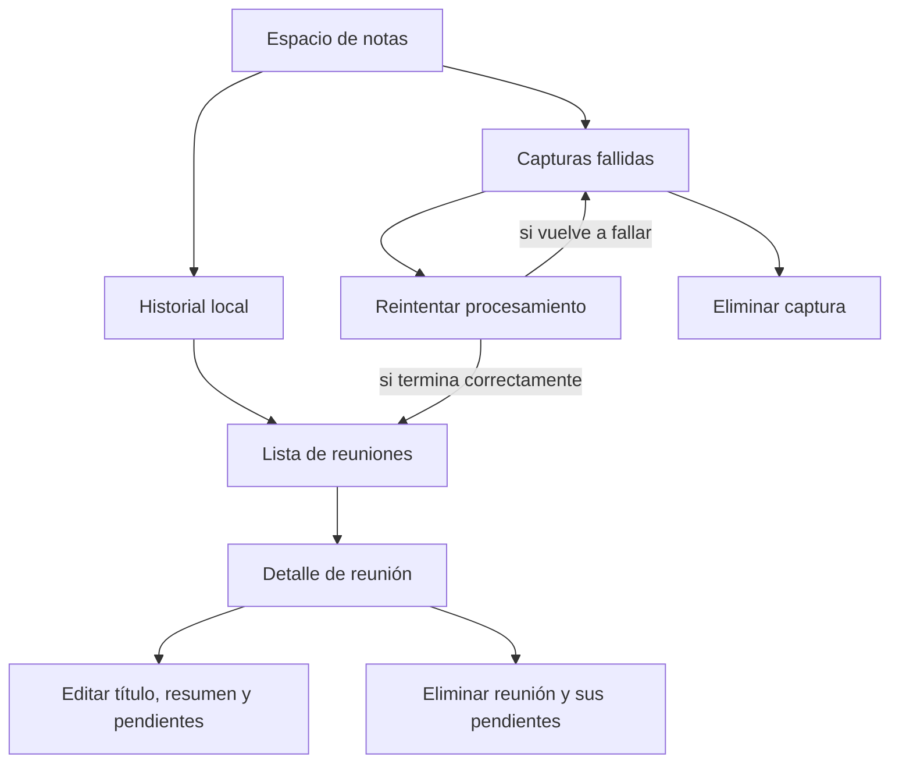

# MN-03 | Definir la arquitectura de información del espacio de notas

**Estado:** Aprobado por Marco (25 de noviembre de 2026).

**Objetivo:** Proponer cómo consultar, revisar, editar y eliminar las notas locales de reuniones, además de acceder a las capturas fallidas que requieren reintento o eliminación.

**Registro de aprobación:** Marco aprobó esta propuesta el 25 de noviembre de 2026.

## Fuente de verdad y límites

- [Alcance aprobado de v1](../decisions/MEETINGNOTES_V1_SCOPE.md): autoridad de producto para esta propuesta.
- [Instrucciones del repositorio](../../AGENTS.md): aplican los límites de alcance y las decisiones técnicas pendientes.

Esta propuesta traduce las capacidades aprobadas de v1 en una jerarquía de información. No implementa páginas, componentes, persistencia ni contratos técnicos.

## Requisitos del alcance que afectan la arquitectura

- Cada computadora tiene su propio historial local de reuniones.
- Se puede consultar y editar el título, el resumen y los pendientes de una reunión. El idioma elegido por reunión también forma parte del registro.
- Los responsables y las fechas de los pendientes aparecen solo cuando se mencionan en la reunión. Las ideas tentativas no se presentan como compromisos.
- Se puede eliminar manualmente una reunión junto con todos sus pendientes.
- Si falla el procesamiento, la captura aparece en una lista para reintentar o eliminar. Se descarta la transcripción y el audio permanece local, sin vencimiento automático, hasta que el procesamiento termine correctamente o la persona usuaria elimine la captura. Si el procesamiento termina correctamente, se eliminan el audio y la transcripción locales.
- La transcripción no forma parte del historial. Los pendientes no tienen estado de completado.

## Propuesta de navegación

## Jerarquía de información

### Lista de reuniones

- Muestra las reuniones guardadas en el historial local.
- Identifica cada reunión por su título.
- Permite abrir el detalle de una reunión.

### Detalle de reunión

- Presenta el título, el idioma elegido, el resumen y los pendientes.
- Incluye responsables y fechas únicamente cuando se mencionan en la reunión.
- Permite pasar a la edición y eliminar manualmente la reunión junto con sus pendientes.
- No presenta la transcripción ni un control para marcar pendientes como completados.

### Edición

- Permite editar el título, el resumen y los pendientes, conforme al alcance de v1.
- No añade campos ni secciones de contenido adicionales.

### Capturas fallidas

- Presenta las capturas cuyo procesamiento falló y ofrece reintentar el procesamiento o eliminar la captura.
- No presenta ni conserva la transcripción fallida. El audio permanece local, sin vencimiento automático, mientras la captura siga pendiente de un reintento exitoso o eliminación manual, según el alcance.

## Decisiones de presentación

La propuesta usa una lista de reuniones y una vista de detalle, con las capturas fallidas en una lista propia. La edición ocurre dentro del detalle mediante un modo de edición, sin una pantalla aparte. El alcance no prescribe el orden de la lista ni la disposición visual; esos aspectos se dejan al diseño de interfaz y no alteran esta jerarquía de información.

## Componentes y contratos afectados

No hay páginas ni componentes del producto implementados en `apps/web/`. Este documento define únicamente una propuesta conceptual de información. No modifica el contrato de API, no elige persistencia o almacenamiento y no añade dependencias.

## Criterios de revisión

- La propuesta cubre consulta, edición y eliminación manual de reuniones con sus pendientes.
- La lista de capturas fallidas refleja las acciones de reintento y eliminación previstas por el alcance.
- El detalle respeta los datos permitidos, incluidos idioma, resumen y pendientes; responsables y fechas solo aparecen cuando se mencionan.
- No se incluyen transcripciones en el historial ni estados de completado para pendientes.
- No se incorporan capacidades o contenido fuera del alcance aprobado.

La propuesta queda aprobada. Este documento no cierra el issue de GitHub.

## Reversión

No aplica reversión de software o datos: este plan solo modifica la propuesta documental de arquitectura de información.
