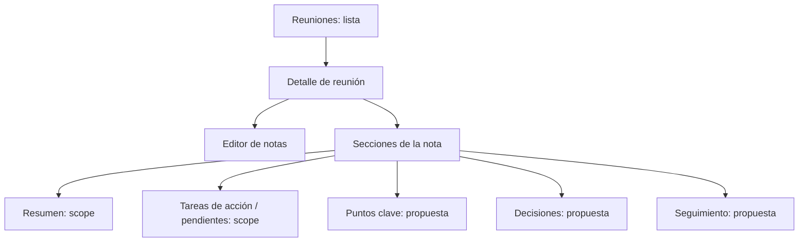

# MN-03 | Definir la arquitectura de información del espacio de notas

**Estado:** Borrador para revisión humana; no aprobado.  
**Objetivo:** Definir cómo las personas encuentran, revisan y organizan sus notas de reuniones.  
**Revisión prevista:** Ronald revisa el mapa del sitio y la estructura de páginas y componentes.

## Fuentes y autoridad

- [Scope aprobado de v1](../MEETINGNOTES_V1_SCOPE.md): baseline de producto para este plan, según la instrucción de priorizar este documento. Describe una aplicación local, historial por computadora, edición de título/resumen/pendientes e idioma de salida por reunión.
- [Instrucciones del repositorio](../../AGENTS.md): siguen aplicando sus límites de no implementar decisiones pendientes ni añadir supuestos de arquitectura.
- [Plan MN-04](./MN-04-wireframes.md): plan aprobado para preparar wireframes estáticos. No determina la arquitectura de información, el almacenamiento ni la exportación.
- [README principal](../../README.md): resume la etapa y estructura del proyecto, pero no define la jerarquía de las notas.
- [Contrato de API](../api/API_CONTRACT.md) y [guía frontend](../FRONTEND_API_GUIDE.md): propuestas sujetas a revisión, no contratos implementados.
- [README de `teams-notes`](<../additional resources/README.md>): contiene la lista de secciones mencionada en MN-03, pero describe otro proyecto. Se usa como referencia para la solicitud, no como decisión aprobada de MeetingNotes.

El archivo `docs/MEETINGNOTES_V1_CONTEXT_TEMP.md`, mencionado en las instrucciones del repositorio, no está presente en el árbol actual. Este plan no lo usa como fuente.

## Hechos y reglas del scope

- El scope de v1 define que MeetingNotes convierte conversaciones en un resumen y una lista de pendientes.
- Cada computadora tiene su propio historial; el scope dice que se guarda localmente y menciona SQLite. Este plan usa el historial local como contexto de navegación, pero no aprueba ni diseña el almacenamiento, el esquema o la persistencia.
- La persona usuaria puede consultar y editar título, resumen y pendientes.
- Los responsables y las fechas solo se incluyen si se mencionan en la reunión. No se deben presentar ideas tentativas como compromisos ni inventar asignaciones o fechas.
- El scope excluye sincronización entre equipos, guardar transcripciones en el historial y marcar pendientes como completados.

## Supuestos de trabajo

- La navegación inicial se representará como una lista de reuniones y un detalle de reunión. Es una propuesta de IA para revisión, no una ruta implementada.
- El resumen y las tareas de acción (pendientes) son las secciones respaldadas por el scope.
- “Puntos clave”, “decisiones” y “seguimiento” se incluyen como secciones candidatas porque las solicita MN-03; requieren decisión de producto antes de considerarse parte del MVP.
- Los nombres de páginas y componentes a continuación son conceptos de diseño, no nombres de archivos ni compromisos de implementación.

## Alcance

### Incluido

- Proponer navegación para lista, detalle y edición de notas.
- Proponer la jerarquía de contenido del detalle de reunión.
- Registrar para decisión de Ronald la inclusión de búsqueda, exportación a Markdown y organización de notas en el MVP.
- Distinguir las decisiones respaldadas por el scope de las propuestas pendientes.

### Fuera de alcance

- Aprobar o diseñar el almacenamiento, el esquema de persistencia o migraciones.
- Definir el comportamiento de exportación a Markdown.
- Incorporar búsqueda, carpetas, etiquetas o colecciones como capacidades del MVP sin decisión de producto.
- Implementar páginas, componentes, contratos de API o dependencias.

## Mapa del sitio candidato

La búsqueda, la exportación y la organización avanzada no se agregan a la navegación propuesta hasta que Ronald decida si pertenecen al MVP.

## Estructura conceptual de páginas y componentes

Los siguientes nombres son ilustrativos y no corresponden a componentes existentes:

- **Lista de reuniones**
  - Encabezado y lista de reuniones.
  - Elemento de reunión con los metadatos que se decidan mostrar.
  - Estado vacío.
  - Búsqueda y controles de organización solo si se aprueban para el MVP.
- **Detalle de reunión**
  - Encabezado con título y metadatos confirmados.
  - Sección de resumen.
  - Lista de pendientes, sin estado de “completado”.
  - Secciones candidatas para puntos clave, decisiones y seguimiento, claramente marcadas como pendientes.
  - Acceso al editor.
- **Editor de notas**
  - Edición del título, resumen y pendientes conforme al scope.
  - Edición de secciones candidatas únicamente si se aprueban.
  - Guardado, cancelación y persistencia sin especificar hasta que se decidan.

Queda abierta la decisión de integrar el editor en el detalle o presentarlo como una vista separada. También debe decidirse si las secciones se presentan en una página continua, como pestañas o mediante otra organización.

## Decisiones para Ronald

| Decisión | Opciones a valorar | Estado |
|---|---|---|
| Puntos clave, decisiones y seguimiento | Incluir en el MVP, combinar con resumen/pendientes o posponer | Pendiente |
| Búsqueda | No incluir; buscar títulos; buscar títulos y contenido | Pendiente |
| Organización | Lista sencilla; etiquetas; carpetas u otra agrupación | Pendiente |
| Exportación a Markdown | Excluir del MVP o definirla con su contenido y comportamiento | Pendiente |
| Edición | Integrada en el detalle o en una vista separada | Pendiente |
| Orden y metadatos de la lista | Acordar qué mostrar y cómo ordenar | Pendiente |

La tabla registra decisiones de producto; no elige una opción ni aprueba almacenamiento o exportación.

## Componentes y contratos afectados

No hay páginas ni componentes de producto implementados en `apps/web/`. El impacto previsto es únicamente una arquitectura conceptual de información para lista, detalle y editor. No se proponen cambios al contrato de API: las propuestas actuales no definen búsqueda ni exportación, y no cubren las secciones candidatas como conceptos separados.

No se agregan dependencias. La elección de herramientas de diseño y la ubicación de cualquier artefacto visual quedan fuera de este plan.

## Riesgos y alternativas

- **Confundir secciones candidatas con alcance aprobado:** marcar puntos clave, decisiones y seguimiento como pendientes hasta que Ronald los decida.
- **Solapamiento de contenido:** aclarar si “resumen ejecutivo” es el resumen del scope o una sección adicional; definir diferencias entre decisiones, pendientes y seguimiento antes de implementarlas.
- **Cerrar almacenamiento o exportación por accidente:** limitar este plan a organización conceptual; no fijar formato, ubicación, esquema ni operación de archivos.
- **Lista sencilla frente a organización avanzada:** una lista sencilla reduce decisiones; etiquetas o carpetas pueden facilitar la organización, pero amplían el alcance y requieren decisión.
- **Editor integrado frente a vista separada:** integrar reduce cambios de contexto; una vista separada puede dar más espacio. La decisión queda abierta.

## Secuencia y validación

1. Confirmar qué secciones forman parte del MVP y distinguirlas de las candidatas.
2. Revisar con Ronald las alternativas de navegación, edición, búsqueda, organización y exportación.
3. Ajustar el mapa del sitio y la estructura conceptual según sus decisiones.
4. Verificar que lista, detalle y editor están representados; que no se incluye el estado “completado”; y que almacenamiento y exportación siguen sin aprobarse en este plan.
5. Registrar comentarios y decisiones de Ronald. El criterio de aceptación solo se satisface cuando la revisión ocurrió.

No hay comandos de validación de producto configurados para esta tarea. No se ejecutan pruebas ni comandos de los POCs.

## Reversión

No aplica reversión de software o datos: este plan no modifica el producto ni define persistencia. Un cambio posterior sería una revisión de la propuesta de IA.
